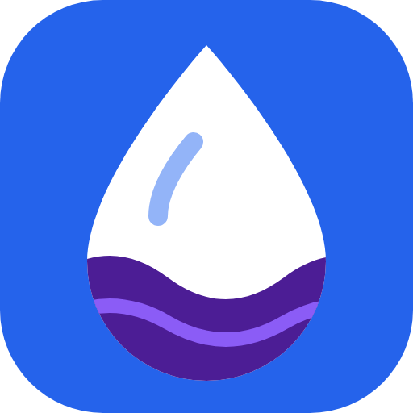

<p align="center"></p>

# Michaneer

**Measure how much water your RO purifier sends down the drain, then get a plan to stop wasting it.**

Michaneer (from Tamil *michcha neer*, leftover water) is a small web app for homes and hostels that drink from a reverse osmosis (RO) purifier. You run a ten minute bucket test with a bottle, a bucket and a measuring jug. Michaneer turns the readings into your purifier's recovery ratio, the litres it sends to the drain each year, and a ranked plan with the litres each step saves. A log keeps your tests so a before and after shows the change you actually made.

**Live demo:** https://applemacbook6sep2004--michaneer.us-east.modal.run

The public demo runs on one small Modal container that sleeps when idle, so the first visit can take a few seconds. On the demo, your log is kept in server memory for your browser only and is wiped when the demo restarts; nothing is written to disk. Run it locally (below) to keep a log.

## The problem

Every RO purifier has a second hose. A Lok Sabha answer (Unstarred Question 778, 17 September 2020) put the reject at "1 to 3 litre per litre of permeate depending on the size and purpose of RO system", and added that no study had been done. That factor of three means a household cannot know its own waste without measuring it.

The rules now expect households to act. MoEF&CC notification G.S.R. 724(E) of 4 October 2021 says "The user shall comply with the guidelines issued by CPCB for management, storage, utilisation and disposal of reject water", and requires every domestic purifier label to state its "Rated recovery efficiency and corresponding water reject generation". CPCB issued those guidelines on 23 September 2026: reuse reject water as far as possible for floor cleaning, toilet flushing and vehicle washing. BIS IS 16240:2023 raised the minimum recovery for new purifiers from 20 to 40 percent. Nobody gives a family a way to check their own unit against any of this. Michaneer does.

## Who it is for

A family in Chennai with an RO unit above the kitchen sink, and whoever runs a hostel or office RO plant. Chennai homes draw from Metrowater pipes, borewells and tanker lorries, with very different dissolved solids, so the same advice does not fit everyone.

## What it does

1. **Bucket test.** Readings: reject millilitres for one bottle of purified water, the jug's marking interval, optional seconds, optional TDS pen readings and the label's rated recovery.
2. **Result.** Recovery with an error range, reject litres a day and a year, and checks against the label, the BIS floor, the IS 10500 TDS limits and the FAO irrigation classes for the reject stream.
3. **Plan, biggest saving first.** Service back to the rated recovery; catch the reject in a bucket for the CPCB uses, capped at what the household can use; and, only if tap water is within 500 mg/L and a lab test agrees, ask whether RO is needed at all.
4. **Log.** Save tests with labels such as "before service" and "after service". The log reports the measured change in litres a year.
5. **Kitchen card.** A printable card in English and Tamil for the wall above the purifier.

Michaneer never says water is safe to drink. A TDS pen cannot detect germs, fluoride, nitrate or arsenic, and the app says so wherever TDS appears.

## Run it

Needs [uv](https://docs.astral.sh/uv/) and Python 3.12 or newer. No API keys, no accounts, no network calls at runtime.

```sh
cd michaneer
uv sync
uv run uvicorn michaneer.app:app --port 8000
```

Open http://127.0.0.1:8000 and press **Fill example readings**, then **See my result**. The example is labelled as illustrative in the app. Saved tests go to `data/michaneer.db`; set `MICHANEER_DB` to use another file.

## Test and evaluate

```sh
uv run pytest -q
uv run python -m eval.run_eval
```

The tests (130) cover the salt balance, the TDS and FAO class boundaries, the plan arithmetic, input validation, the log round trip, the Tamil card and the rule that no page loads third-party scripts. The evaluation writes [eval/RESULTS.md](eval/RESULTS.md) from published figures only. Headlines:

* One person drinking and cooking with 7.5 L a day (WHO) sends **2,738 to 8,212 litres a year** to the drain across the official 1 to 3 litre range. Moving from the top of that range to the 2023 BIS floor saves 4,106 litres per person per year before any reuse.
* A kitchen jug marked every 100 mL pins recovery within 3.6 percentage points, so the test always separates a 25 percent unit from a 40 percent unit.
* At 25 percent recovery, tap water above about **342 mg/L** already makes reject water that FAO does not class as unrestricted for irrigation. The popular "pour it on your plants" tip is only right for low-TDS supplies, so the app decides from the computed reject TDS.

## How the numbers work

* Recovery R = purified / (purified + reject). Error range from half a jug marking either way on the reject reading.
* Reject TDS from the salt balance: (tap TDS minus R times purified TDS) / (1 minus R). Without a purified reading, the app uses the upper bound tap TDS / (1 minus R).
* Litres a year = daily purified litres times reject per litre times 365.
* Service saving = daily purified litres times (reject per litre now minus reject per litre at the rated recovery) times 365. The label rating is the target when given, else 40 percent.
* Reuse = the smaller of the reject left after service and the litres a day the household can use, times 365.

## Sources

All checked on 6 November 2026. Full entries render on the app's Sources page and live in [michaneer/sources.py](michaneer/sources.py).

* BIS IS 10500:2012 Drinking Water Specification, Table 2 (TDS 500 mg/L acceptable, 2000 mg/L permissible).
* BIS IS 16240:2023, RO point-of-use purifiers (minimum recovery 40 percent, up from 20 percent in 2015).
* MoEF&CC G.S.R. 724(E), 4 October 2021, Environment (Protection) 115th Amendment Rules.
* CPCB, Guidelines for Handling, Storage, Management, Utilisation and Disposal of RO Reject Water and Discarded Elements, 23 September 2026.
* Lok Sabha Unstarred Question 778, 17 September 2020.
* NGT, O.A. 134/2015, orders of 20 May 2019 and 1 December 2021; Supreme Court stay of the latter, reported 1 March 2022.
* FAO Irrigation and Drainage Paper 29 Rev. 1, Water quality for agriculture, Table 1.
* WHO, Domestic Water Quantity, Service Level and Health, Howard and Bartram, 2003.

## Built with

Python, FastAPI, Jinja2, Uvicorn, SQLite and pytest, all open source. Server-rendered HTML and one CSS file; the only scripts are the print and back buttons. The logo is original: a jamun red bucket catching the reject stream from the purifier's second hose, with jug markings down its side, drawn by hand as flat SVG.

## Hosted demo

`modal_app.py` deploys the demo with `modal deploy modal_app.py`: a quarter CPU, 256 MB, scale to zero, `MICHANEER_HOSTED=1`. In that mode the log is per browser (a random cookie id) and in memory only.

## Limits

* One bucket test is one moment. Recovery moves with inlet pressure, temperature and filter age, so test again after a service and every few months.
* The evaluation uses published figures and grids, not field measurements. Real before and after readings belong in the log, labelled as such.
* There is no public count of RO purifiers in Chennai, so Michaneer does not claim a city-wide total.
* The CPCB 2026 guideline text is cited from a regulatory summary because the CPCB PDF did not load from our network, and the Lok Sabha answer is quoted as indexed by search for the same reason.

## Layout

```
modal_app.py    hosted demo on Modal
michaneer/      app.py (routes), model.py (all arithmetic), store.py (SQLite log), sources.py, templates/, static/
tests/          pytest suite
eval/           run_eval.py and RESULTS.md
docs/           SUBMISSION.md, DEMO.md, screenshots/
assets/         logo.svg, logo-512.png
DESIGN.md       idea selection and scoring
RULES.md        hackathon rules as recorded
```
